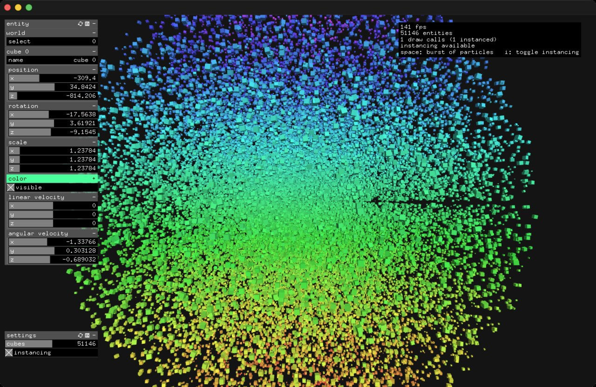

# ofxEnTT

[](https://github.com/danoli3/ofxEnTT/actions/workflows/ci.yml)



*`example_instancing`: 51,146 entities, one instanced draw call, with the ofxGui inspector.*

[EnTT](https://github.com/skypjack/entt) for openFrameworks: a fast entity component system, with
a world that runs its systems every frame, a transform hierarchy, instanced rendering, JSON save /
load, and bridges to `ofParameter`, ofxGui, ofxImGui and ofxAssimpModelLoader.

EnTT 4.0.0 (header-only, MIT, by Michele Caini) is included in `libs/entt`.

## Requirements

- openFrameworks 0.12.1 or later (master), any build system: make, projectGenerator (Xcode, Visual
  Studio, VS Code), or CMake
- C++20 (EnTT 4). macOS, iOS, Visual Studio 2022 / 2026, Emscripten and Linux already build with
  C++20 or later; `addon_config.mk` raises MSYS2 and Raspberry Pi armv6 / armv7 to C++20. Visual Studio
  2019 (C++17) isn't supported.
- Instanced drawing needs the programmable renderer: `ofGLWindowSettings::setGLVersion(3, 3)`, or
  GLES 3 / WebGL 2. Without it, entities are drawn one by one.

## Quick start

```cpp
#include "ofxEnTT.h"
using namespace ofxEnTT;

World world;
auto cube = std::make_shared<ofVboMesh>(ofMesh::box(10, 10, 10));

// setup
for (int i = 0; i < 10000; i++) {
	auto e = world.create("cube");
	world.registry.get<Transform>(e).position = glm::sphericalRand(500.f);
	world.registry.emplace<Velocity>(e, glm::vec3(0), glm::vec3(0, 1, 0)); // spins
	world.registry.emplace<MeshRenderer>(e, cube).color = ofFloatColor::orange;
}

// update
world.update();

// draw
cam.begin();
world.draw();   // 10000 cubes, one instanced draw call
cam.end();
```

`world.registry` is a plain `entt::registry`, so the whole EnTT API is there: views, groups, sorting,
signals, snapshots, and your own components. Add your own systems with
`world.addSystem("name", [](World & w, float dt) { ... })`.

## Components

| Component | |
|---|---|
| `Name` | display name (inspectors, JSON, `findByName`) |
| `Transform` | local position, orientation (quaternion; Euler helpers in degrees), scale |
| `WorldTransform` | world matrix, written by the TransformSystem each update |
| `Parent` / `Children` | hierarchy; use `World::setParent` (refuses cycles) |
| `MeshRenderer` | shared `ofVboMesh`, optional `ofTexture` / `ofMaterial`, colour, draw mode, `visible` |
| `Hidden` | tag: not drawn. Prefer `MeshRenderer.visible` when toggling every frame |
| `Velocity` | linear (units/s) and angular (rad/s) motion |
| `Lifetime` | destroyed when it reaches zero |

## World

- `create(name)`, `create(count)` (instance pools), `destroy(e)` (with its children), `clear()`, `size()`, `isValid(e)`
- `setVisible(e, bool)` / `isVisible`: `MeshRenderer.visible` when the entity has a mesh (no component churn); otherwise the Hidden tag
- `setHidden(e, bool)` / `isHidden`: add or remove the Hidden tag
- `setParent(child, parent)`, `getParent`, `getChildren`, `getRoots`, `getEntities`
- `findByName`, `getName`, `getBounds(e, min, max)` (world-space bounds of e and its children)
- `clone(e)`: copies an entity and its children, sharing meshes, so the copies draw instanced
- `addSystem` / `removeSystem` / `hasSystem`: run in the order added, after Velocity and Lifetime and
  before the TransformSystem
- `update()` / `draw()`, or `setAutoUpdate(true)` / `setAutoDraw(true)` to run them from OF's events

## Rendering

The RenderSystem groups visible `MeshRenderer`s by mesh, texture and draw mode. Each group is one
`drawInstanced` call: per-instance matrices and colours go into vertex attributes 5-9 of the mesh's
VBO, and a built-in shader draws them with simple directional lighting (`renderer.lighting`,
`renderer.lightDirection`). Entities with an `ofMaterial` are drawn one at a time (ofMaterial has its
own shader). `renderer.instancing = false` draws everything one at a time. `renderer.getStats()` gives
draw calls and entity counts.

Textures are sampled as `sampler2D`: call `ofDisableArbTex()` before loading them.

`MeshRenderer.visible = false` (or `world.setVisible(e, false)`) leaves the entity in the registry and skips it in `collectBatches`. Use that for large pools that show and hide every frame. The Hidden tag is for inspectors and JSON.

2D instance pools (quads, disks) should set `world.renderer.lighting = false` unless the mesh has useful normals. Lighting is already off when a mesh has no normals.

Shared meshes: `makeQuad(w, h)`, `makeDisk(radius, segments)`, `makeBox(w, h, d)` return `shared_ptr<ofVboMesh>` for `MeshRenderer`.

## CPU performance

The merged default paths used **36–51% less CPU frame time** in these measured
scenes. Compared [the pre-optimization code](https://github.com/danoli3/ofxEnTT/commit/da60c3bc8b321469433fd2215978310fa36912d2)
with [the six merged optimizations](https://github.com/danoli3/ofxEnTT/commit/76b3900994a753d3e323d26c1475acca73a4793f)
on 2026-11-15, using identical scenes with 32 mesh batches:

| Scene | Before | Merged defaults | Less time |
|---|---:|---:|---:|
| 20,000 linear movers | 1.536 ms | 0.844 ms | 45.1% |
| 20,000 rotating movers | 1.765 ms | 1.132 ms | 35.9% |
| 200,000 linear movers | 20.298 ms | 10.022 ms | 50.6% |
| 200,000 rotating movers | 24.432 ms | 13.406 ms | 45.1% |

Apple M1 Max (10 cores, 64 GiB), macOS 26.6.2, Apple Clang 21, ARM64 Release
(`-O3 -DNDEBUG`). Medians of 13 samples after four warmup frames, with separate
executables measured in shuffled serial order. Each sample contains 30 frames at
20k entities or 10 frames at 200k. Times include complete world updates and CPU
render-data collection/packing; setup, first allocations, validation, GPU uploads
and drawing are excluded. These are CPU timings, not measured FPS gains.

For the 200k rotating scene, explicitly enabling the owning group and four total
threads reduced this CPU stage to **10.876 ms (55.5% less than the old baseline)**.
Optional paths are workload-dependent: parallel scheduling, transform snapshots,
and copying bulk particle data back to ECS can cost more than they save. All 46
comparisons matched exactly in this run across 132,760,000 checked float values.

**Run the examples:** [per-feature benchmarks](benchmarks/README.md) and the
[full before/after comparison](benchmarks/revisions/README.md). The
[measurement details](benchmarks/results/merged-vs-baseline.md),
[raw samples](benchmarks/results/merged-vs-baseline.json), and
[31-sample bulk follow-up](benchmarks/results/merged-vs-baseline-bulk-followup.json)
are included in the addon.

Run the combined CPU-frame comparison from the addon root:

```sh
python3 benchmarks/revisions/run.py --filter pipeline
```

## Optional CPU performance paths

`world.enableVelocityGroup()` creates an EnTT owning group for `Transform` and
`Velocity`. Call it during setup if most of your work iterates those two types.
It is off by default. Group creation reorders both pools, invalidating cached
component addresses; ownership persists for the registry's lifetime. Independently
sorting those pools or creating conflicting owning groups is then unsupported.
Entity IDs, built-in motion behavior, and hierarchy semantics stay the same.

`world.transforms.setIncremental(true)` caches local-transform snapshots and
recomputes matrices only when an entity or its ancestors change. Direct writes to
position, orientation and scale are detected; `markDirty(entity)` forces a refresh,
and `invalidate()` discards the snapshots. Reparenting and missing world matrices
are detected too. The cache is off by default and still visits the hierarchy each
frame. It adds per-entity memory/comparison work and can lose on frequently moving
scenes. Only recomputed matrices emit `WorldTransform` update notifications in this
mode. Inspect `world.transforms.getStats()` for updated/skipped matrix counts.

For large independent linear-particle pools, `LinearMotionBatch` keeps six
contiguous float arrays so the compiler can vectorize across entities:

```cpp
ofxEnTT::LinearMotionBatch particles;
particles.reserve(20000);
particles.add(position, velocity, entity); // entity binding is optional
particles.update(dt);
particles.syncTo(world); // optional serial copy to bound entities' local positions
world.update(dt);
```

The batch owns its positions/velocities. Do not also attach a built-in `Velocity`
to a bound entity unless two integration steps are intended. Rotation, hierarchy,
lifetime, and world matrices remain the world's responsibility. Deleted entity
versions are skipped during sync. Removing an item swaps the last item into its
index; `clear()` retains capacity. Span accessors expose the six fixed-size arrays
without permitting mismatched vector lengths. Copying results into ECS components
has a cost; kernel-only SIMD gains do not imply a faster whole frame. No global
GLM alignment changes, NEON-only code, or architecture flags are required.

`world.workers.setThreadCount(4)` opts built-in motion into a persistent worker
pool (four includes the caller). It gathers matched component pointers before
launching disjoint ranges, joins them, then handles expiry, user systems, deferred
commands and transforms on the calling thread. Small jobs stay serial;
`velocityMinItemsPerThread` defaults to 4096. The default thread count is one.
Extra gathering/scheduling work can lose on cheap motion, so benchmark your scene.

The same executor can run `particles.update(dt, world.workers)` (default minimum
16384 items/thread) or custom `forEachRange(count, callback, minItemsPerThread)`
jobs. Callbacks receive `[begin, end)` and must write disjoint data without adding,
removing or sorting registry components. Use `world.defer([entity](World & w) {
if (w.isValid(entity)) w.destroy(entity); })` to queue structural work. Commands
run after all user systems return, before transform propagation; commands queued
while draining wait for the next update. Cross-worker command ordering is not
guaranteed. Drain commands and configure/submit jobs only on the calling thread;
`defer` itself is thread safe. Worker exceptions rethrow after every worker joins.
The pool supports resizing, rejects nested jobs, and is joined on destruction.
Ordinary WebAssembly builds without pthread support fall back to one thread.
Transform propagation remains sequential to preserve parent-before-child order,
and all GL drawing stays on the calling thread.

Reproducible before/after CPU measurements live in [benchmarks](benchmarks/README.md).

## JSON

```cpp
ofxEnTT::saveJson(world, "scene.json");
ofxEnTT::loadJson(world, "scene.json");   // Name, Transform, Parent, Velocity, Lifetime, Hidden, colour, visible
```

Meshes, textures and materials aren't saved: give them back to the loaded entities, e.g. by name.

## Bridges

The ofParameter bridge is part of the addon. The others are header-only: include them, and add their
addon to the project, only where you use them.

### ofParameter

`ofxEnTT::EntityParameters` turns one entity's components into an `ofParameterGroup`. Changing a
parameter writes the component, and `pull()` (each frame) follows systems that move the entity. The
group only lists the components the entity has, and `groupChanged` fires when that changes.

### ofxGui (`ofxEnTTGui.h`, ofxGui)

```cpp
ofxEnTT::GuiInspector inspector;
inspector.setup(world);     // setup
inspector.update();         // update, after world.update()
inspector.draw();           // draw, outside the camera
inspector.select(entity);
```

### ofxImGui (`ofxEnTTImGui.h`, [ofxImGui](https://github.com/jvcleave/ofxImGui) `develop` branch)

```cpp
ofxEnTT::Entity selected = ofxEnTT::Null;
gui.begin();
ofxEnTT::imgui::inspector(world, selected);   // tree, create / clone / destroy, component editors
gui.end();
```

`ofxEnTT::imgui::entityTree` and `entityEditor` are there for your own windows.

### ofxAssimpModelLoader (`ofxEnTTAssimp.h`, ofxAssimpModelLoader)

```cpp
auto model = std::make_shared<ofxAssimpModelLoader>();
model->load("druid.gltf");
auto druid = ofxEnTT::addModel(world, model, "druid");   // root + a child per mesh
auto another = world.clone(druid);                      // shares the meshes: instanced
ofxEnTT::updateModelAnimations(world);                  // in update, for animated models
```

`ModelOptions`: `materials` (keep `ofMaterial`s instead of using the diffuse colour), `textures`, and
`yUp` (on by default: removes the loader's 180 degree turn for OF's y-down screen, so models stand
upright under `ofEasyCam`).

## Examples

| Example | Addons | |
|---|---|---|
| `example_instancing` | ofxGui | 20,000 spinning cubes in one draw call; space bursts particles with a Lifetime |
| `example_hierarchy` | ofxGui | a solar system of parent / child transforms; s / l save and load JSON |
| `example_assimp` | ofxAssimpModelLoader, ofxGui | a model as entities, cloned into an instanced grid; drop a model file to swap it |
| `example_imgui` | [ofxImGui](https://github.com/jvcleave/ofxImGui) (`develop`) | the ImGui inspector on a spinning ring of groups |
| `example_tests` | ofxUnitTests | the addon's headless regression tests |

Generate the project files with projectGenerator, or copy `scripts/templates/<platform>/Makefile`
and `config.make` (or the CMake template) into the example folder.

## License

ofxEnTT: MIT, Dan Rosser. EnTT: MIT, Michele Caini (`libs/entt/license/LICENSE`).
